# Manual de usuario — NexusFisi

NexusFisi es la plataforma de **trámites académicos de la UNMSM**: el estudiante presenta su solicitud en línea, la sigue paso a paso y recibe la respuesta sin hacer colas. El personal de cada facultad las evalúa, asigna y atiende desde una bandeja.

Algunos trámites siguen necesitando un paso presencial (por ejemplo, recoger un documento firmado). En ese caso la solicitud indica **qué oficina atiende y dónde está** (pabellón, piso y ventanilla).

**Dirección:** la que comunique tu facultad (en la demostración, `https://nexusfisi.onrender.com`).
**Navegadores:** Chrome, Edge, Firefox o Safari actualizados, en computadora o celular.

## Contenido

1. [Ingresar y crear una cuenta](#1-ingresar-y-crear-una-cuenta)
2. [Estudiante](#2-estudiante)
3. [Supervisor de la facultad](#3-supervisor-de-la-facultad)
4. [Técnico o responsable](#4-técnico-o-responsable)
5. [Administrador](#5-administrador)
6. [Estados de una solicitud](#6-estados-de-una-solicitud)
7. [Preguntas frecuentes](#7-preguntas-frecuentes)

## 1. Ingresar y crear una cuenta

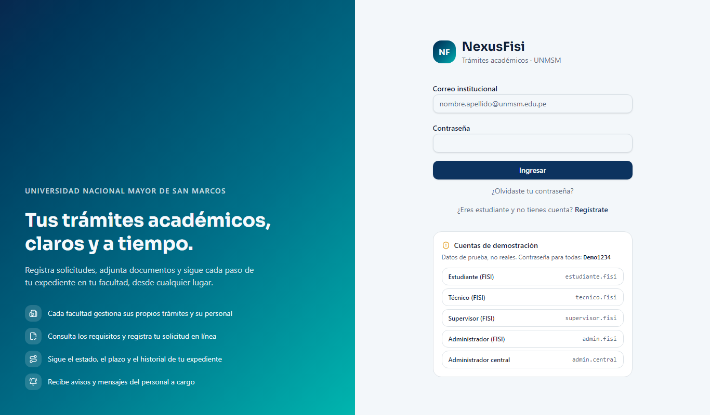

- **Ingresar:** escribe tu correo institucional (`…@unmsm.edu.pe`) y tu contraseña, y pulsa **Ingresar**.
- **Crear cuenta (solo estudiantes):** pulsa **Regístrate**, completa tus nombres y apellidos, correo institucional, código de estudiante, facultad, escuela profesional y una contraseña de al menos 8 caracteres con letras y números, y pulsa **Crear cuenta de estudiante**. Las cuentas del personal las crea el administrador.
- **¿Olvidaste tu contraseña?** Pulsa el enlace, escribe tu correo y recibirás un enlace válido por **30 minutos** para crear una nueva. Al cambiarla se cierran tus sesiones abiertas en otros equipos.
- Tras **5 intentos fallidos** la cuenta se bloquea unos minutos, para protegerla.

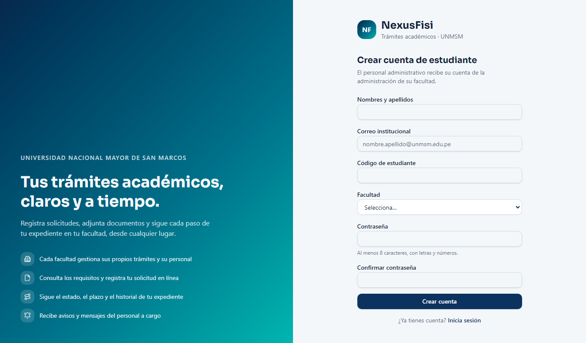

## 2. Estudiante

### Panel principal

Muestra cuántas solicitudes tienes y en qué estado, y las más recientes. La campana de la esquina superior avisa cuando una de tus solicitudes cambia.

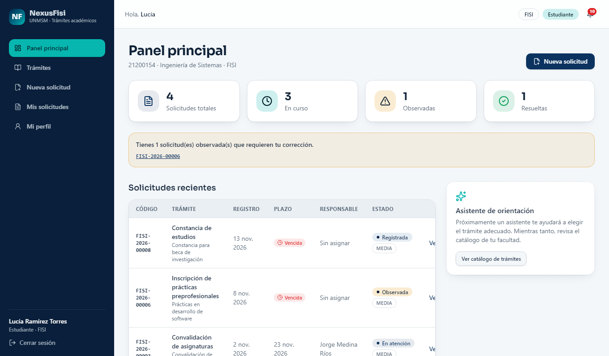

### Consultar los trámites disponibles

En **Trámites** ves el catálogo de tu facultad: requisitos, plazo de atención en días hábiles y la oficina que lo atiende.

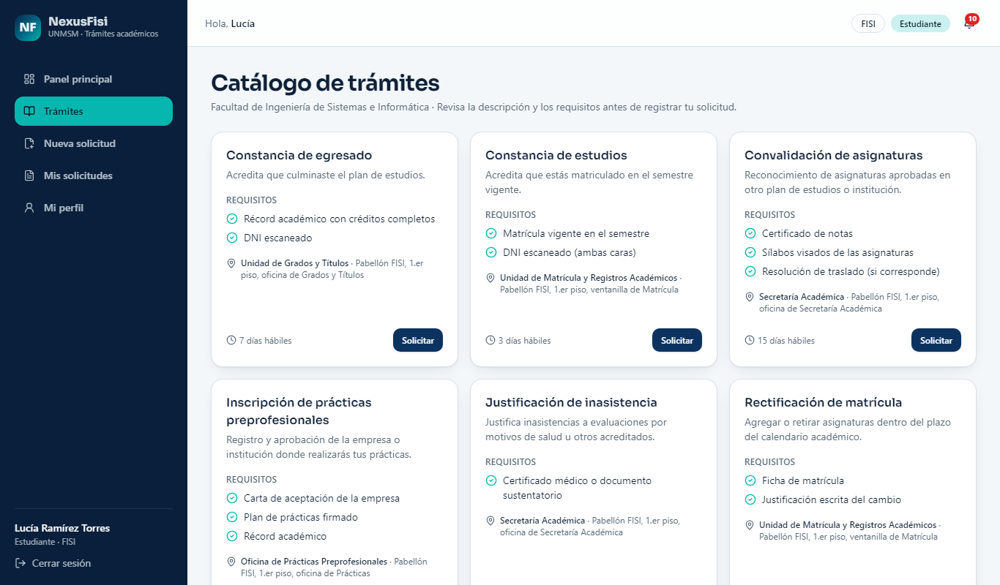

### Registrar una solicitud

1. Entra a **Nueva solicitud**.
2. Elige el **tipo de trámite**: aparecen sus requisitos.
3. Escribe un **asunto** y una **descripción** clara de lo que necesitas.
4. Adjunta los documentos (PDF, JPG o PNG, hasta 5 MB cada uno). Es obligatorio al menos uno.
5. Pulsa **Registrar solicitud**. Recibirás un **código** (por ejemplo `FISI-2026-00012`) con el que puedes hacer seguimiento.

Si falta un dato, el formulario lo marca en rojo y la solicitud no se registra.

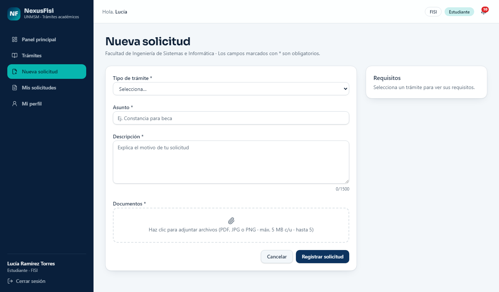

### Seguir tus solicitudes

En **Mis solicitudes** puedes buscar y filtrar por estado. Al abrir una ves sus datos, los documentos, los mensajes con el personal y el **historial** de cada cambio con fecha y responsable.

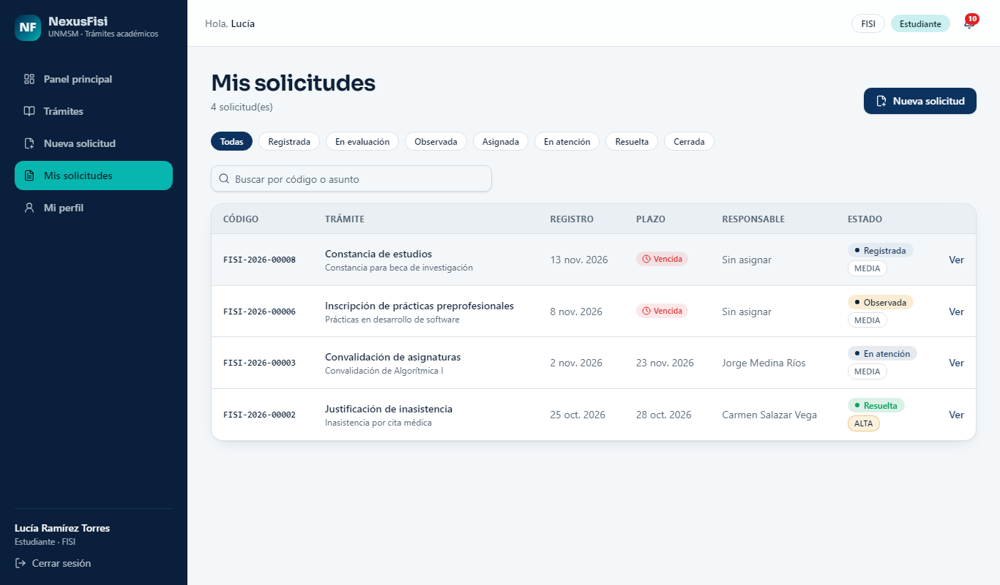
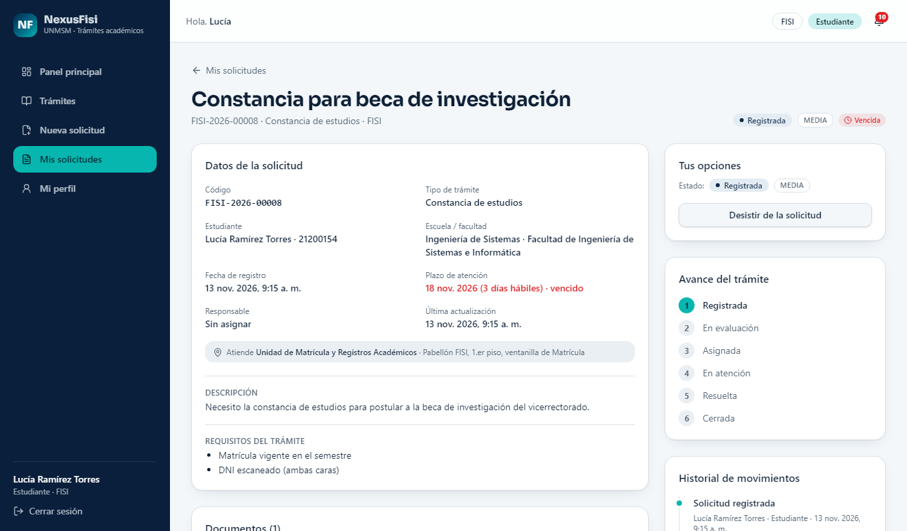

### Si tu solicitud es observada

El personal te dirá qué corregir (lo verás en el detalle y te llegará un correo). Explica el cambio, adjunta el documento corregido y pulsa **Enviar corrección**. La solicitud vuelve a revisión.

### Cuando está resuelta

Descarga la respuesta o constancia desde **Documentos**. Si estás de acuerdo, pulsa **Estoy conforme · cerrar** y el expediente se cierra. Si no lo estás, pulsa **No estoy conforme** y explica el motivo: vuelve a atención con el mismo responsable (solo una vez).

### Desistir

Mientras no tenga un responsable asignado (registrada, en evaluación u observada), puedes pulsar **Desistir de la solicitud** si ya no la necesitas. El expediente se cierra y no se puede reabrir.

## 3. Supervisor de la facultad

### Bandeja

Reúne todas las solicitudes de tu facultad, ordenadas por prioridad y antigüedad (las terminadas al final). Puedes filtrar por estado, prioridad, tipo y responsable, y ver cuáles están **vencidas**.

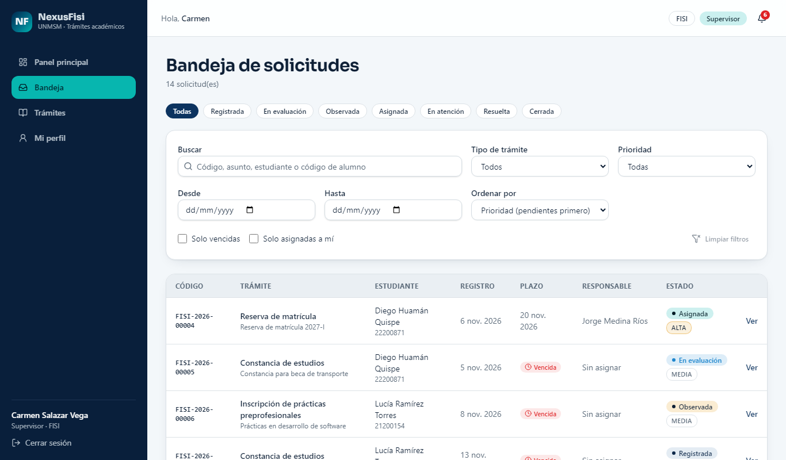

### Atender una solicitud

Desde el detalle, el panel **Acciones** muestra solo lo que puedes hacer en ese momento:

| Acción                          | Cuándo                                                                                  |
| ------------------------------- | --------------------------------------------------------------------------------------- |
| **Iniciar evaluación**          | Solicitud nueva: revisas datos y documentos. El estudiante es notificado.               |
| **Observar / pedir corrección** | Falta o está mal algo. La nota es obligatoria y le llega al estudiante.                 |
| **Asignar responsable**         | Está conforme: eliges el técnico y la prioridad.                                        |
| **Reasignar**                   | Cambiar de técnico; el anterior deja de tener acceso.                                   |
| **Cambiar prioridad**           | Urgente, Alta, Media o Baja.                                                            |
| **Cerrar expediente**           | Solicitud resuelta: el supervisor puede cerrarla si el estudiante no da su conformidad. |

Cada acción pide confirmación. Si otra persona cambió la solicitud mientras la mirabas, el sistema te avisa y muestra el estado actualizado para que no se pisen los cambios.

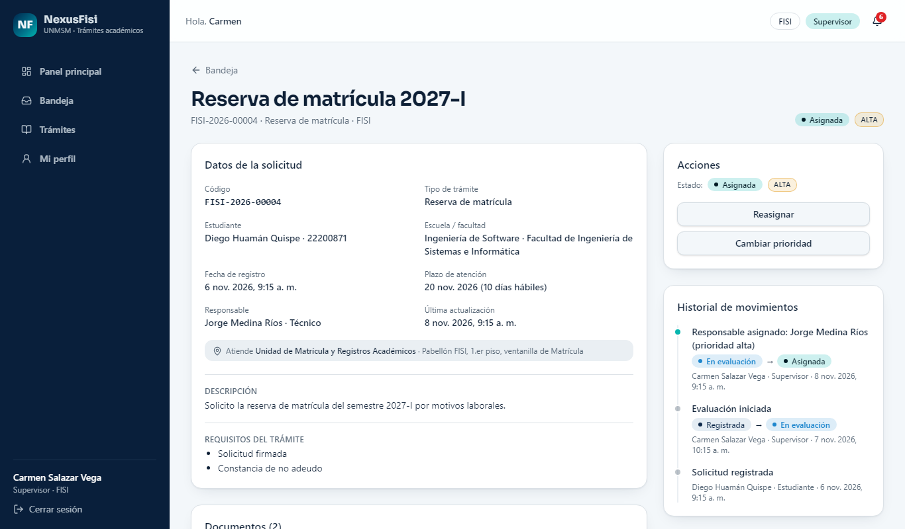

### Panel con indicadores

El **Panel principal** del supervisor muestra: registradas, pendientes, atendidas, vencidas, porcentaje resuelto, tiempo promedio de atención y gráficos por estado, tipo, prioridad y responsable.

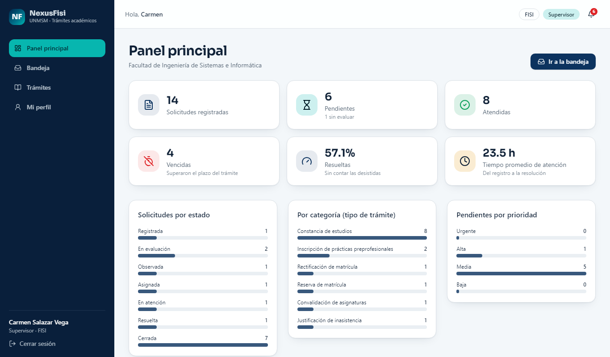

## 4. Técnico o responsable

En **Mis asignaciones** ves solo las solicitudes que te asignaron.

1. Abre la solicitud y pulsa **Iniciar atención**.
2. Trabaja el trámite. Puedes escribir mensajes al estudiante o **observar** si necesitas algo de él.
3. Adjunta la respuesta o constancia y pulsa **Resolver**, escribiendo la respuesta. El estudiante recibe un aviso.

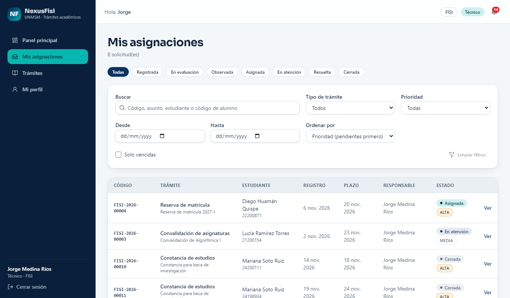

## 5. Administrador

En **Administración** se gestionan:

- **Usuarios:** crear personal, cambiar su rol, área o facultad y desactivar cuentas (la sesión de una cuenta desactivada se cierra de inmediato). No se puede desactivar a un técnico con solicitudes en curso sin reasignarlas antes.
- **Tipos de trámite:** nombre, requisitos, plazo en días hábiles, área que lo atiende y si está activo.
- **Áreas responsables:** oficina, ubicación (pabellón, piso, ventanilla) y horario.
- **Facultades y escuelas:** solo el **administrador central** crea facultades; el de cada facultad administra la suya.

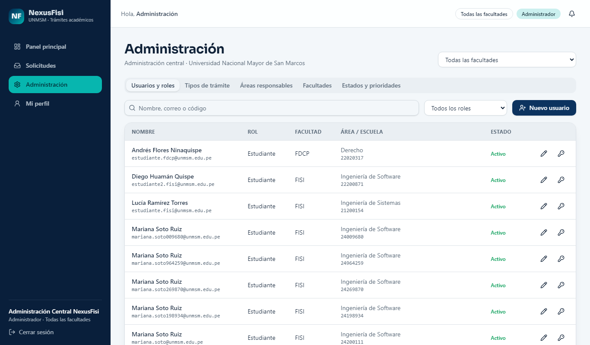

## 6. Estados de una solicitud

```
Registrada → En evaluación → Asignada → En atención → Resuelta → Cerrada
                  ↓    ↑                     ↓   ↑
               Observada (el estudiante corrige)
```

| Estado            | Significa                                                                    |
| ----------------- | ---------------------------------------------------------------------------- |
| **Registrada**    | La recibimos; aún nadie la revisa.                                           |
| **En evaluación** | El supervisor revisa los datos y documentos.                                 |
| **Observada**     | Hay algo que corregir; espera tu corrección.                                 |
| **Asignada**      | Ya tiene un responsable.                                                     |
| **En atención**   | El responsable está trabajando en ella.                                      |
| **Resuelta**      | Tiene respuesta; descárgala y da tu conformidad.                             |
| **Cerrada**       | Terminó (con tu conformidad, por desistimiento o cerrada por el supervisor). |

El **plazo** se cuenta en días hábiles (lunes a viernes, hora de Lima) desde el registro. Es una estimación: los feriados todavía no se descuentan.

## 7. Preguntas frecuentes

**No me llega el correo de recuperación.** Revisa _spam_ y _Promociones_. El enlace vence a los 30 minutos; puedes pedir otro (el anterior deja de servir).

**Me rechaza un documento.** Solo se aceptan PDF, JPG y PNG reales, de hasta 5 MB. Un archivo renombrado (por ejemplo un `.docx` llamado `.pdf`) se rechaza.

**No veo una solicitud que sé que existe.** Cada facultad solo ve las suyas, y un técnico solo las que le asignaron.

**Aparece «Ocurrió un error inesperado… informa el código …».** Copia ese código y envíalo a soporte: con él se encuentra exactamente qué pasó.

**La página tarda en abrir la primera vez.** En la demostración (plan gratuito de Render) el servidor se duerme sin uso; la primera visita tarda alrededor de un minuto.
