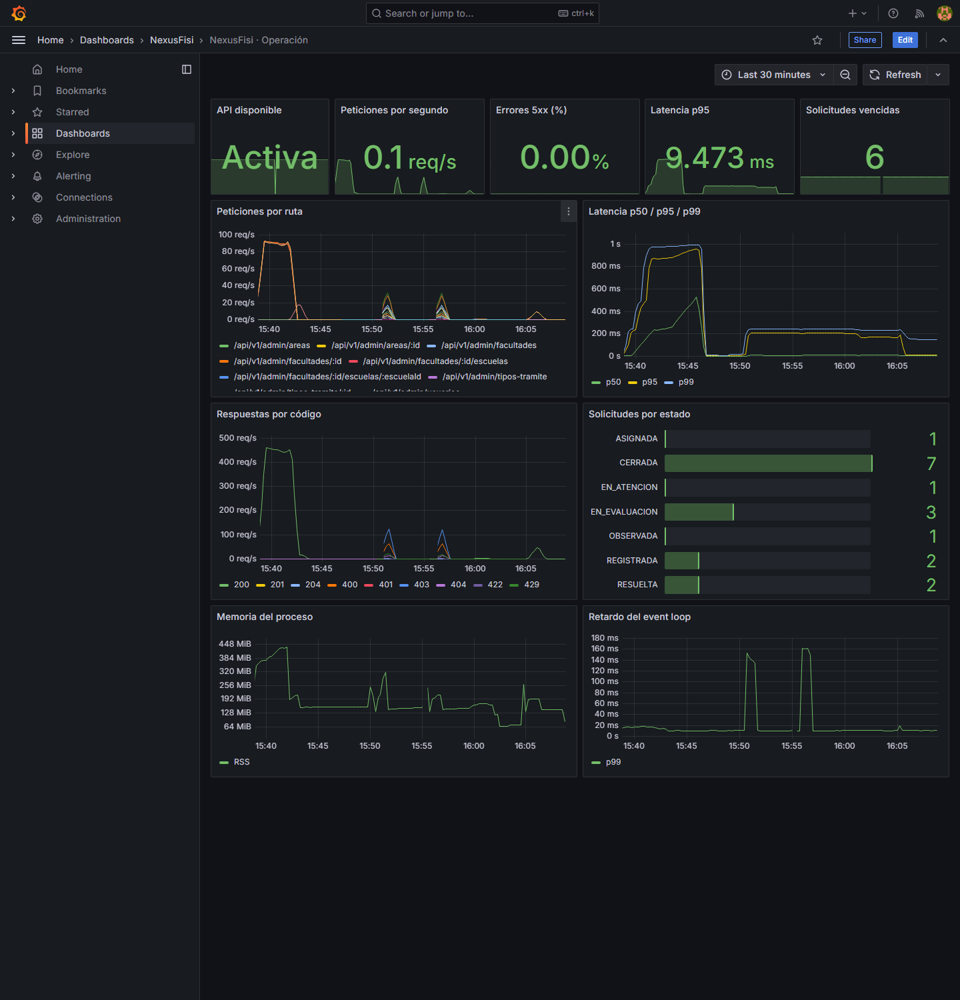
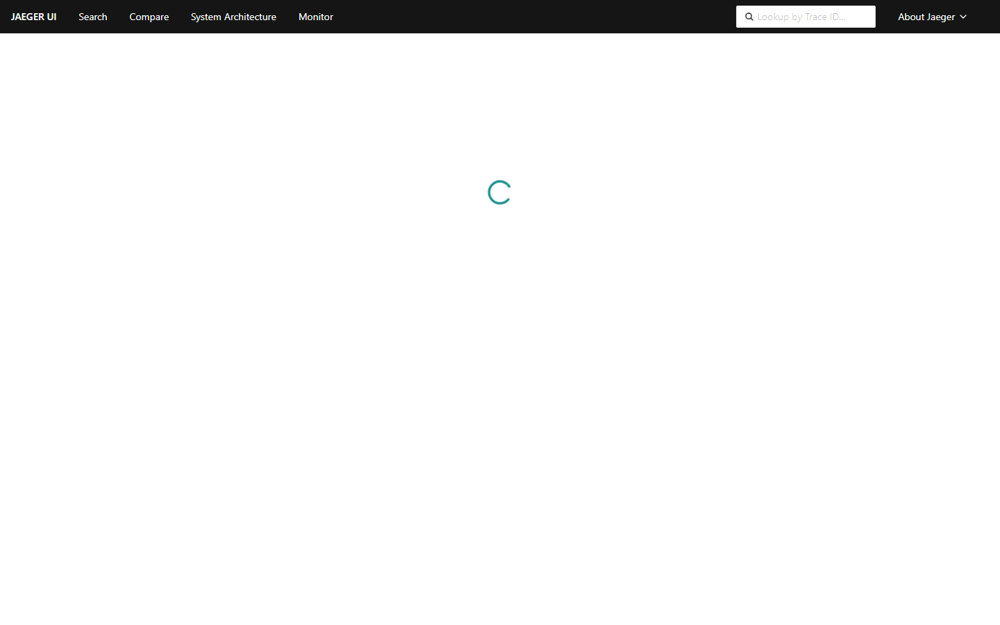
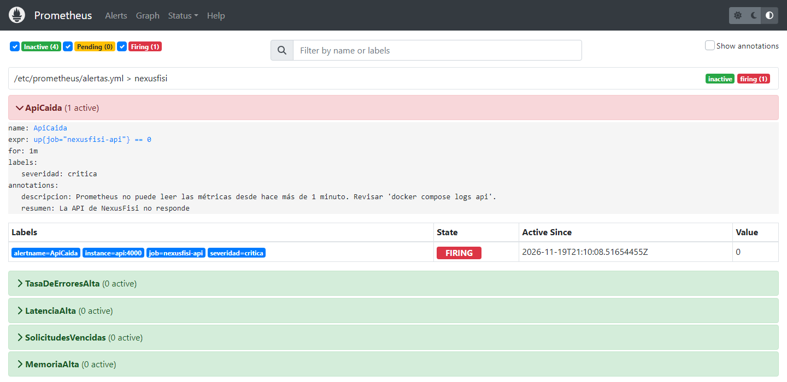

# Observabilidad y operación

NexusFisi expone las tres señales clásicas (**logs, métricas y trazas**), las une con un mismo identificador y define **alertas** y un **procedimiento de incidentes**. Todo es opcional y se activa por configuración: sin las variables, la API funciona igual y no envía nada.

```
                      ┌──────────── logs JSON (pino) ── stdout ──▶ docker logs / Render Logs
Navegador ─▶ nginx ─▶ API ── métricas ── /api/v1/metrics ◀── Prometheus ──▶ alertas ──▶ Grafana
   X-Request-Id ──────┘ └── trazas OTLP ──────────────────────────────▶ Jaeger ◀──────────┘
```

| Señal                        | Tecnología                                         | Dónde se ve                                                       |
| ---------------------------- | -------------------------------------------------- | ----------------------------------------------------------------- |
| Logs                         | pino (JSON en una línea)                           | `docker compose logs api`, panel _Logs_ de Render                 |
| Métricas                     | prom-client → Prometheus 2.55                      | Grafana `http://localhost:3001` (tablero «NexusFisi · Operación») |
| Trazas                       | OpenTelemetry (auto-instrumentación) → Jaeger 1.62 | `http://localhost:16686`                                          |
| Alertas                      | Reglas de Prometheus                               | `http://localhost:9090/alerts` y Grafana                          |
| Disponibilidad de producción | GitHub Actions (cada 10 min)                       | Pestaña _Actions → Monitoreo_                                     |

## Levantar el stack de observabilidad

```bash
cd deploy
# en .env: METRICS_TOKEN (≥16 caracteres), OTEL_EXPORTER_OTLP_ENDPOINT=http://jaeger:4318, GRAFANA_ADMIN_PASSWORD
docker compose --profile observabilidad up -d
```

Los puertos de Grafana (3001), Prometheus (9090) y Jaeger (16686) quedan solo en `127.0.0.1`: no se publican a internet.

## 1. Logs

Cada petición produce una línea JSON:

```json
{
  "level": 30,
  "time": 1795122367045,
  "service": "nexusfisi-api",
  "trace_id": "89d423de70d5b2645637155ec48e75c4",
  "span_id": "adc7e7f0cb6d3c15",
  "requestId": "8c87172fbe4ad9be0351f27f1f44667f",
  "method": "GET",
  "path": "/api/v1/solicitudes/FISI-2026-00006",
  "status": 200,
  "ms": 5,
  "msg": "request"
}
```

- **`requestId`**: lo genera nginx (o la API si no hay gateway), viaja en la cabecera `X-Request-Id` de la respuesta y aparece en el mensaje de error que ve el usuario («informa el código …»). Solo se acepta el del gateway si tiene forma de identificador, para que nadie inyecte texto en los logs.
- **`trace_id`**: lo agrega la instrumentación de OpenTelemetry. Permite saltar del log a la traza en Jaeger.
- **Datos sensibles**: `authorization`, `password`, `passwordHash` y `token` se reemplazan por `[oculto]` (configuración `redact` de pino).
- **Niveles**: `LOG_LEVEL` (por defecto `info`). Los errores no controlados se registran como `error` con la pila completa.

## 2. Métricas

`GET /api/v1/metrics` (formato Prometheus). En producción exige `Authorization: Bearer <METRICS_TOKEN>`; sin token configurado, el endpoint no existe (404).

| Métrica                                                | Tipo       | Para qué                                         |
| ------------------------------------------------------ | ---------- | ------------------------------------------------ |
| `nexusfisi_http_peticiones_total{metodo,ruta,estado}`  | contador   | Tráfico y errores por endpoint                   |
| `nexusfisi_http_duracion_segundos{metodo,ruta,estado}` | histograma | Latencia p50/p95/p99                             |
| `nexusfisi_solicitudes{estado}`                        | gauge      | Expedientes por estado (negocio)                 |
| `nexusfisi_solicitudes_vencidas`                       | gauge      | Expedientes pendientes fuera de plazo (negocio)  |
| `nexusfisi_process_*`, `nexusfisi_nodejs_*`            | varios     | Memoria, CPU, _event loop_, recolector de basura |

La etiqueta `ruta` es el **patrón** (`/api/v1/solicitudes/:codigo`), nunca la URL real: con un código por expediente, las series crecerían sin límite (una prueba automática lo verifica).

El tablero de Grafana se carga solo (_provisioning_) con 11 paneles: disponibilidad, peticiones por segundo, % de errores 5xx, latencia p95, vencidas, peticiones por ruta, latencias p50/p95/p99, respuestas por código, solicitudes por estado, memoria y retardo del _event loop_.



## 3. Trazas

Se activan con `OTEL_EXPORTER_OTLP_ENDPOINT`. [`api/src/telemetria.ts`](../api/src/telemetria.ts) se carga antes que la aplicación (`node --import ./dist/telemetria.js`) e instrumenta HTTP y **mysql2**, así que cada traza muestra la petición y cada consulta SQL con su duración. El span HTTP se renombra con la ruta de Hono (`GET /api/v1/solicitudes/:codigo`) y lleva el `requestId`; si la petición termina en una excepción, el span queda en rojo con la pila.



Se desactivaron las instrumentaciones de `fs`, `dns` y `net` porque generan cientos de spans sin valor diagnóstico.

## 4. Alertas

Definidas en [`deploy/observabilidad/alertas.yml`](../deploy/observabilidad/alertas.yml):

| Alerta                | Condición                                    | Durante | Severidad             |
| --------------------- | -------------------------------------------- | ------- | --------------------- |
| `ApiCaida`            | Prometheus no puede leer las métricas        | 1 min   | crítica               |
| `TasaDeErroresAlta`   | Más del 5 % de respuestas 5xx                | 5 min   | crítica               |
| `LatenciaAlta`        | p95 mayor que 1 s                            | 10 min  | advertencia           |
| `SolicitudesVencidas` | Más de 10 expedientes fuera de plazo         | 30 min  | advertencia (negocio) |
| `MemoriaAlta`         | Memoria residente de la API mayor que 400 MB | 10 min  | advertencia           |

En producción (Render), el workflow [`monitoreo.yml`](../.github/workflows/monitoreo.yml) consulta `/api/v1/health` cada 10 minutos en horario de atención; si falla tres veces seguidas, el job termina en error y GitHub avisa por correo. De paso evita que el plan gratuito duerma el servicio.

## 5. Gestión de incidentes

### Simulacro realizado (19/11/2026)

Se detuvo la API para comprobar la detección de extremo a extremo:

| Hora     | Evento                                                                  |
| -------- | ----------------------------------------------------------------------- |
| 16:09:43 | `docker compose stop api` (falla simulada). El gateway responde 502.    |
| 16:10:08 | Prometheus detecta `up == 0`: alerta `ApiCaida` **pendiente**.          |
| 16:11:08 | Tras 1 minuto, la alerta pasa a **disparada** (_firing_).               |
| 16:11:30 | Se reinicia la API (`docker compose start api`).                        |
| 16:11:59 | `/api/v1/health` responde `{"status":"ok","db":"ok"}`. Alerta resuelta. |

Tiempo de detección: ≈ 1,5 min. Tiempo de recuperación: ≈ 2,3 min desde la falla.



### Procedimiento (runbook)

1. **Detectar.** Llega la alerta (Prometheus/Grafana o el correo del workflow de monitoreo), o un usuario informa un código de error.
2. **Clasificar.** ¿Qué alerta? `ApiCaida` → paso 3a; `TasaDeErroresAlta` → 3b; `LatenciaAlta`/`MemoriaAlta` → 3c; `SolicitudesVencidas` → avisar a los supervisores (es de negocio, no técnica).
3. **Diagnosticar.**
   - **a. Caída:** `docker compose ps` y `docker compose logs api --tail 100` (en Render: _Events_ y _Logs_). Lo habitual: la base no responde (`/api/v1/health` muestra `db: "error"`), variable de entorno inválida (la API no arranca y dice cuál), memoria agotada.
   - **b. Errores 5xx:** en Grafana, panel _Respuestas por código_ → qué ruta falla. Buscar en los logs `"level":50` y tomar su `trace_id`; abrir la traza en Jaeger para ver qué consulta o paso falló.
   - **c. Lentitud:** panel _Latencia por ruta_ → endpoint lento; en Jaeger, ordenar trazas de esa ruta por duración y ver qué span SQL domina.
4. **Mitigar.** Reiniciar el servicio, revertir al despliegue anterior (Render: _Rollback_; VM: `docker compose up -d` con el tag anterior) o escalar.
5. **Cerrar y aprender.** Registrar qué pasó, cuánto duró y qué se cambió (por ejemplo, una prueba nueva o una alerta más fina).

### Depurar un error que informa un usuario

El usuario ve: _«Ocurrió un error inesperado. Si persiste, informa el código 8c87172f…»_.

```bash
docker compose logs api | grep 8c87172f          # la línea del error (pila y trace_id) y la de la petición (ruta y estado)
# abrir http://localhost:16686/trace/<trace_id>   → la petición completa con sus consultas SQL
```

En Render se busca el mismo código en el panel _Logs_.
